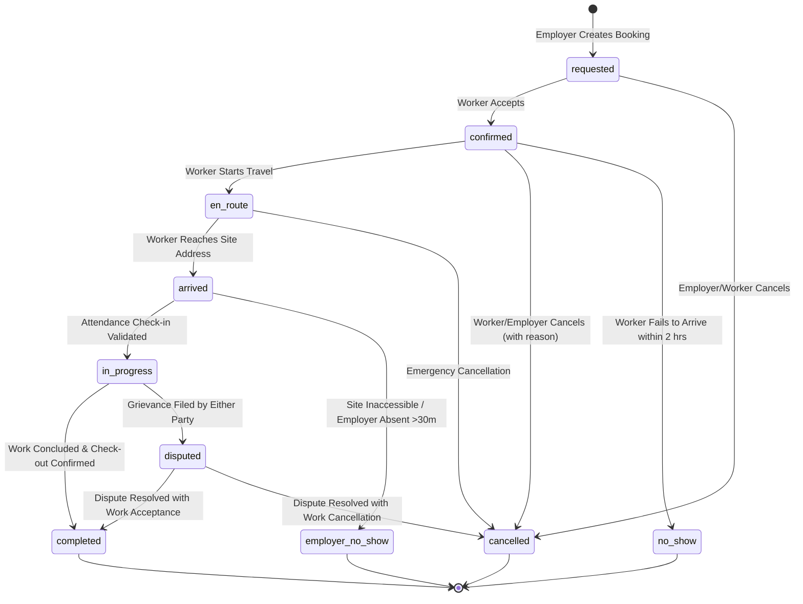
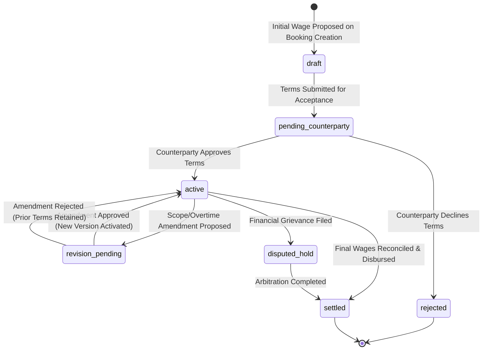
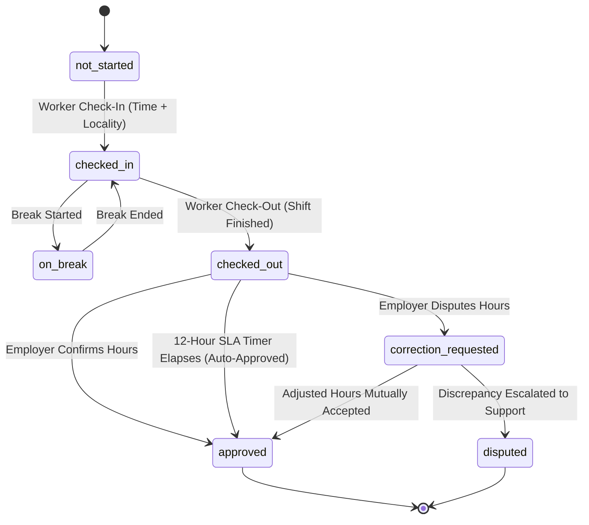
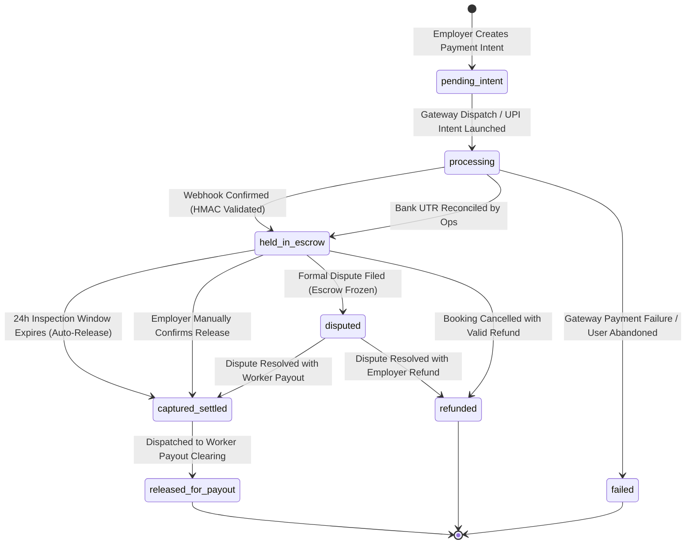
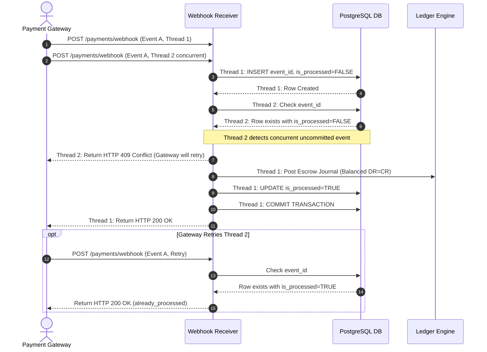
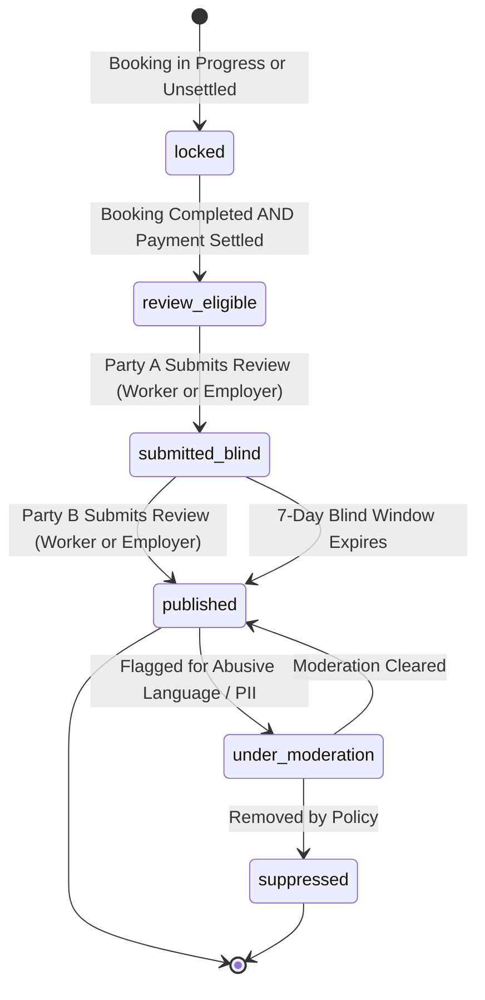
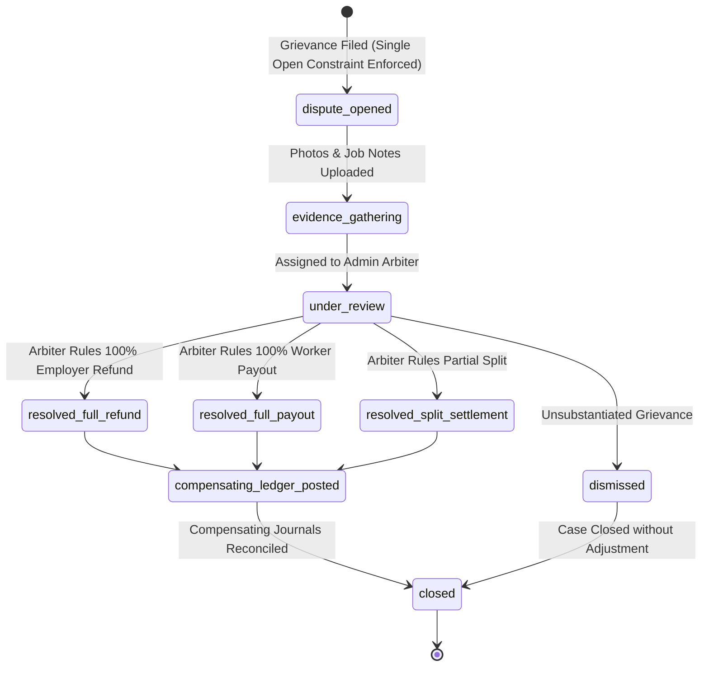

# KAAMSETU STAGE 2, STEP 6.0.1 — WORKFLOWS & STATE DIAGRAMS (CORRECTED)

**Component:** State Machines & Transition Validation  
**Pilot Geography:** Chhatrapati Sambhajinagar, Maharashtra  
**Document Reference:** `STEP6_0_1_WORKFLOWS_AND_STATE_DIAGRAMS.md`  
**Version:** 2.0.0 (Post-Adversarial Audit Revision)

---

## 1. Booking Operational Lifecycle (Synchronized 10-State FSM)

The operational lifecycle tracks physical milestones. It is fully synchronized with database enum `booking_status_enum` (addressing **AUD-KS6-004**).

### Transition Matrix & Permitted Actors
| Current Status | Target Status | Permitted Actor | Prerequisite / Rule | Side Effects |
| :--- | :--- | :--- | :--- | :--- |
| `requested` | `confirmed` | Worker | Worker confirms availability for scheduled time slot. | Wage agreement transitions to `pending_counterparty`. |
| `requested` | `cancelled` | Employer / Worker | Either party cancels prior to confirmation. | Zero penalty; advance deposit refunded 100%. |
| `confirmed` | `en_route` | Worker | Permitted up to 2 hours before `scheduled_at`. | Triggers travel timestamp `en_route_at`. |
| `confirmed` | `cancelled` | Employer / Worker | Reason required. | If employer cancels $<2$ hrs, ₹150 mobilization fee debited. |
| `confirmed` | `no_show` | Employer | Worker has not triggered `arrived` within 2 hours of `scheduled_at`. | Full refund to employer; worker reliability cooldown. |
| `en_route` | `arrived` | Worker | Worker reaches destination (optional GPS within 500m). | Triggers timestamp `arrived_at`. |
| `arrived` | `in_progress` | Worker + Employer | Check-in triggered by worker and confirmed by employer. | Triggers `started_at`; shift checkpoint begins. |
| `arrived` | `employer_no_show`| Worker | Employer absent from premises after 30 minutes. | ₹150 mobilization fee released to worker from escrow. |
| `in_progress` | `completed` | Employer / Auto-Timer | Employer confirms check-out OR 12h SLA timer elapses. | Sets `completed_at`; starts 24h payment inspection window. |
| `in_progress` | `disputed` | Employer / Worker | Formal grievance lodged prior to final sign-off. | Freezes escrow payout sweep (`payment.status -> disputed`). |
| `completed` | *Any* | **NONE** | **Terminal State.** Immutable; cannot be reopened. | Unlocks review submission. |
| `cancelled` | *Any* | **NONE** | **Terminal State.** Immutable; cannot be reopened. | Terminal. |
| `no_show` | *Any* | **NONE** | **Terminal State.** Immutable; cannot be reopened. | Terminal. |
| `employer_no_show`| *Any* | **NONE** | **Terminal State.** Immutable; cannot be reopened. | Terminal. |

---

## 2. Wage Agreement Lifecycle (7-State FSM)

Persisted explicitly via `status: wage_agreement_status_enum` (addressing **AUD-KS6-005**).

### Transition Matrix
| Current Status | Target Status | Permitted Actor | Prerequisite / Rule |
| :--- | :--- | :--- | :--- |
| `draft` | `pending_counterparty` | Creator | Initial base rate and terms entered. |
| `pending_counterparty` | `active` | Counterparty | Counterparty accepts wage rate and agreement type. |
| `pending_counterparty` | `rejected` | Counterparty | Counterparty rejects proposed terms. |
| `active` | `revision_pending` | Worker / Employer | Scope expansion or extra hours proposed with justification. |
| `revision_pending` | `active` | Counterparty | Counterparty approves amendment (updates active amounts). |
| `active` | `disputed_hold` | Worker / Employer | Formal wage grievance lodged. |
| `disputed_hold` | `settled` | Admin / Arbiter | Arbitration resolution posted to ledger. |
| `active` | `settled` | System | Payout disbursed and reconciled. Terminal state. |

---

## 3. Attendance Checkpoint Lifecycle (With 12-Hour Auto-Approval SLA)

Addresses **AUD-KS6-012** by preventing unconfirmed check-outs from stalling payouts.

---

## 4. Inbound Customer Payment & Escrow Lifecycle (Synchronized)

Addresses **AUD-KS6-006** by explicitly tracking escrow custody and inspection release.

---

## 5. Webhook Ingestion & Anti-Race Idempotency FSM

Addresses **AUD-KS6-003** by guaranteeing duplicate webhooks cannot acknowledge `HTTP 200` before the primary transaction commits.

---

## 6. Review & Rating Lifecycle (Composite Uniqueness)

Addresses **AUD-KS6-001** by enforcing `UNIQUE (booking_id, author_role)`.

---

## 7. Dispute & Grievance Arbitration Lifecycle

Addresses **AUD-KS6-015** by enforcing single active dispute per booking.

