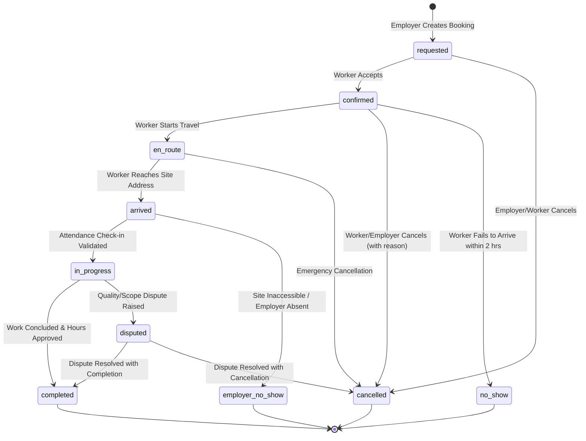
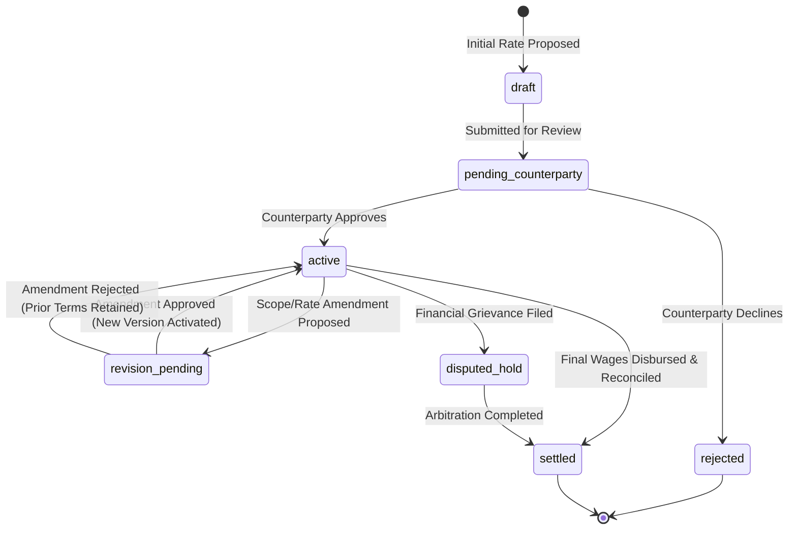
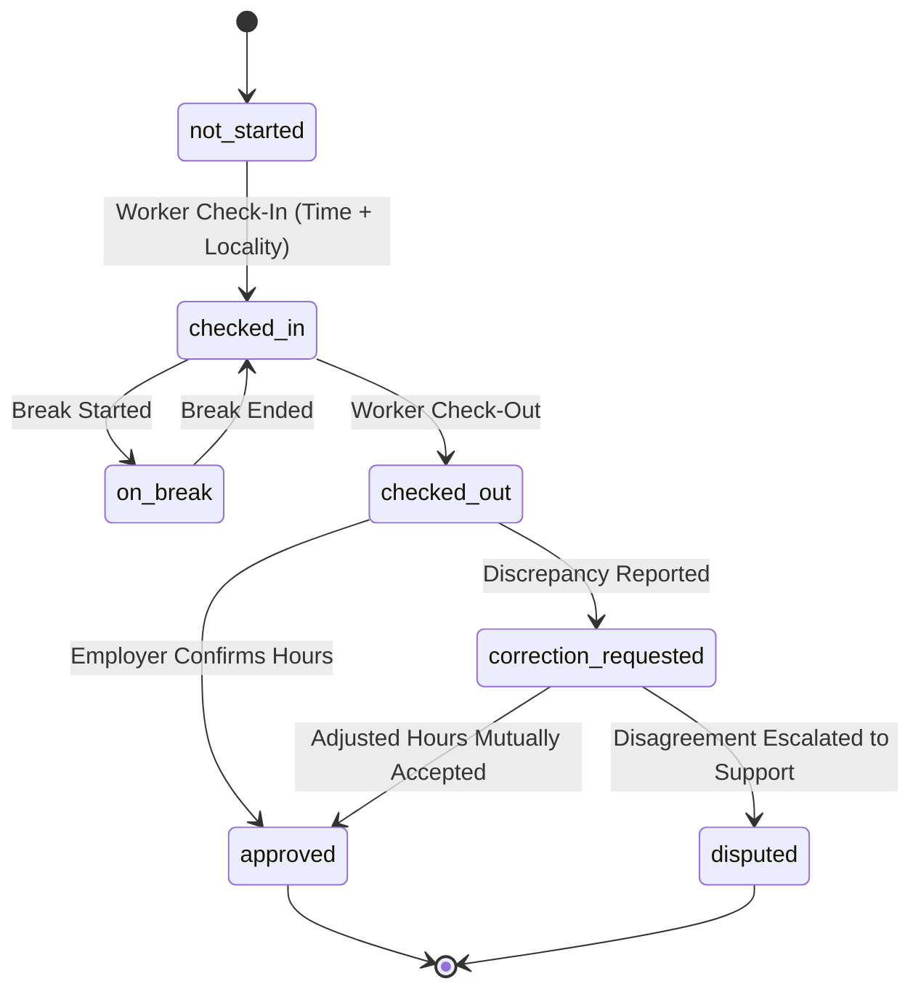
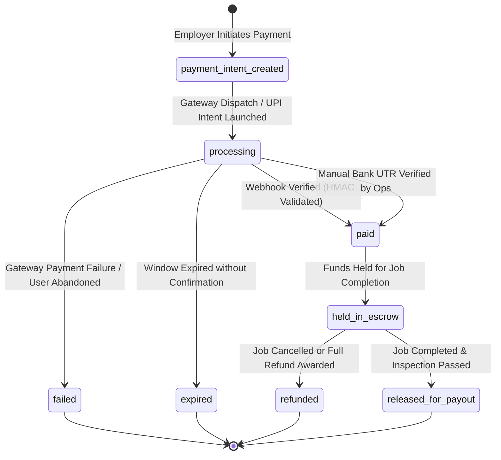
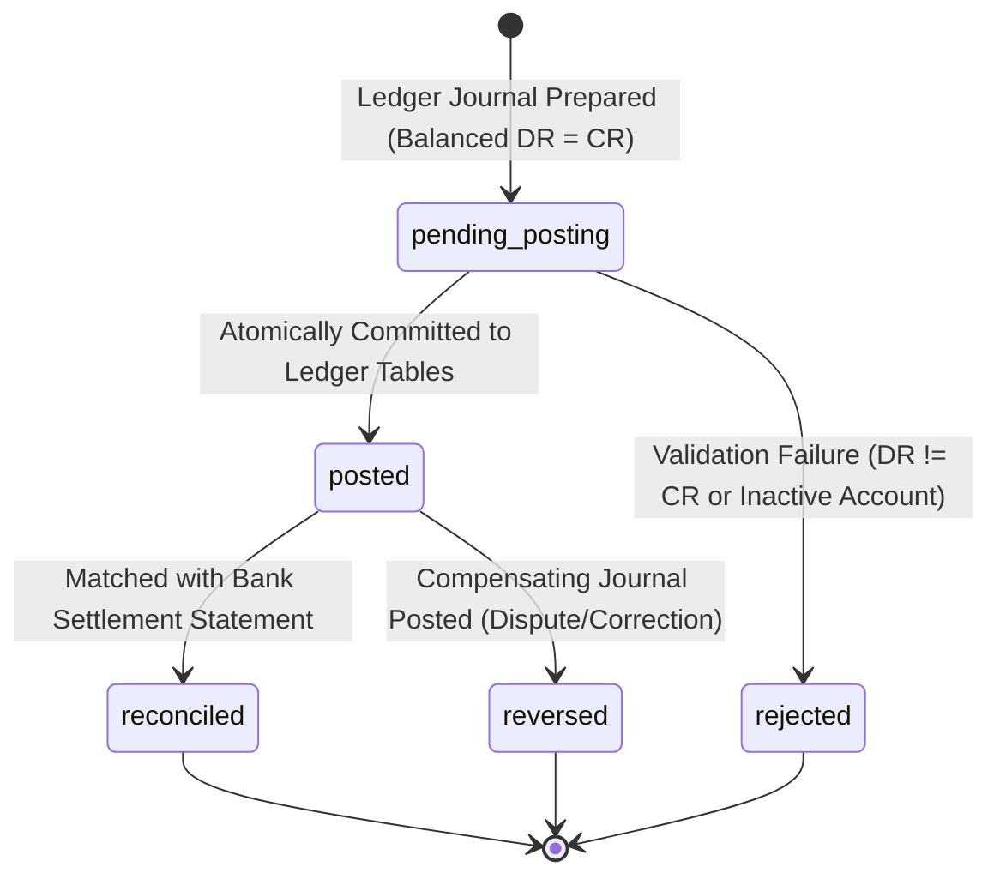
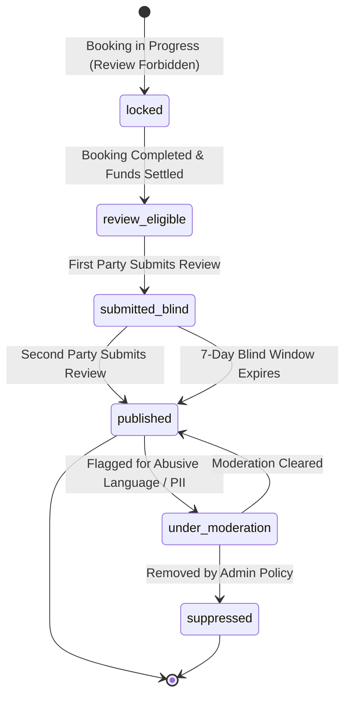
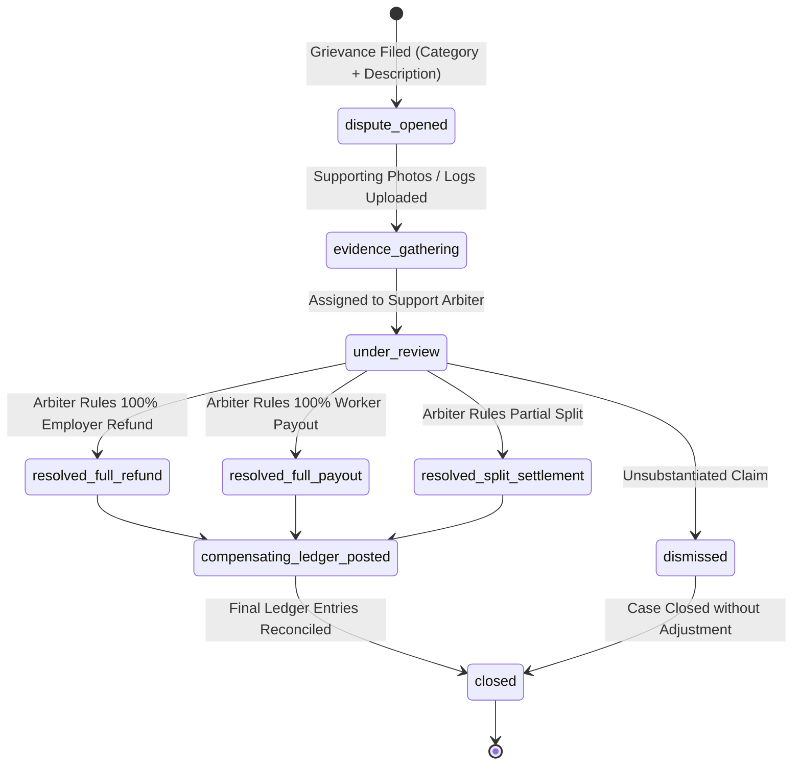

# KAAMSETU STAGE 2, STEP 6.0 — WORKFLOWS & STATE DIAGRAMS
**Component:** State Machines & Transition Validation  
**Pilot Geography:** Chhatrapati Sambhajinagar, Maharashtra  
**Document:** `STEP6_0_WORKFLOWS_AND_STATE_DIAGRAMS.md`

---

## 1. Booking Operational Lifecycle

The operational lifecycle tracks the real-world progression of a work order. Booking completion is decoupled from payment capture and payout settlement.

### Transition Matrix & Permitted Actors
| Current Status | Target Status | Permitted Actor | Prerequisite / Rule |
| :--- | :--- | :--- | :--- |
| `requested` | `confirmed` | Worker | Worker explicitly confirms availability for scheduled time slot. |
| `requested` | `cancelled` | Employer / Worker | Either party can cancel prior to confirmation without penalty. |
| `confirmed` | `en_route` | Worker | Permitted up to 2 hours before `scheduled_at`. |
| `confirmed` | `cancelled` | Employer / Worker | Reason required. Cancellation fees may apply to employer if $<2$ hrs. |
| `confirmed` | `no_show` | Employer | Worker has not triggered `arrived` within 2 hours of `scheduled_at`. |
| `en_route` | `arrived` | Worker | Worker is at site address (verified by locality/optional GPS). |
| `arrived` | `in_progress` | Worker + Employer | Check-in triggered by worker and confirmed by employer. |
| `arrived` | `employer_no_show`| Worker | Employer absent from premises after 30 minutes. |
| `in_progress` | `completed` | Employer | Final shift check-out confirmed and deliverables accepted. |
| `in_progress` | `disputed` | Employer / Worker | Formal dispute lodged prior to final sign-off. |
| `completed` | *Any* | **NONE** | **Terminal State.** Immutable; cannot be reopened. |
| `cancelled` | *Any* | **NONE** | **Terminal State.** Immutable; cannot be reopened. |

---

## 2. Wage Agreement Lifecycle

Governs the contractual rate and versioned scope amendments.

---

## 3. Attendance Checkpoint Lifecycle

Governs daily check-in, breaks, check-out, and correction workflows.

---

## 4. Inbound Customer Payment Lifecycle

Tracks customer payment transactions from payment intent through gateway verification.

---

## 5. Double-Entry Ledger Transaction Lifecycle

Tracks financial journals ensuring complete auditability and zero balance discrepancy.

---

## 6. Review & Rating Lifecycle

Enforces verification gating and blind-review retaliation protections.

---

## 7. Dispute & Grievance Arbitration Lifecycle

Governs formal grievances, evidence evaluation, and financial adjustments.

