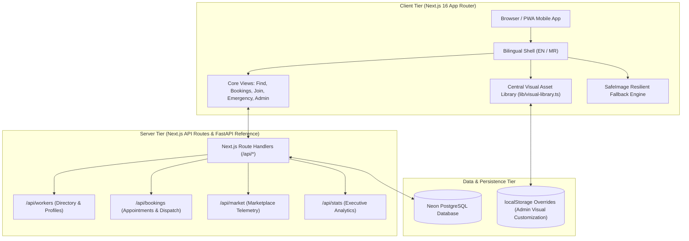
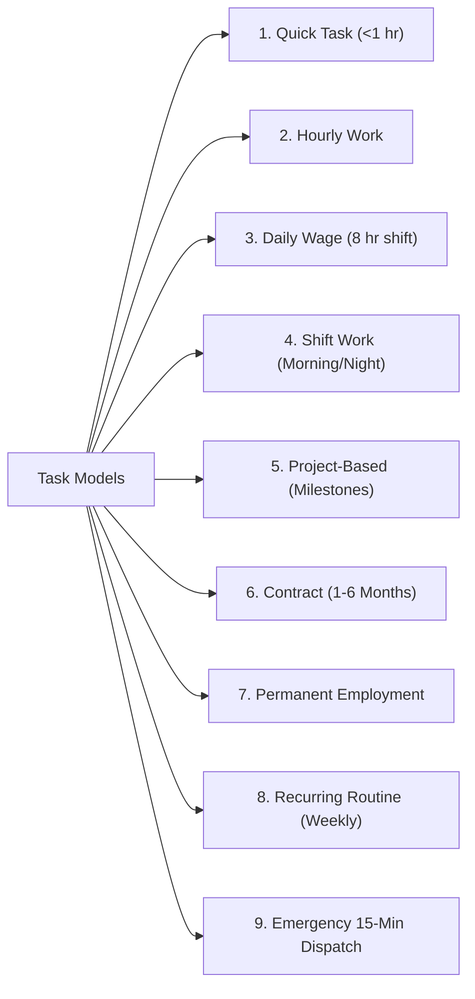
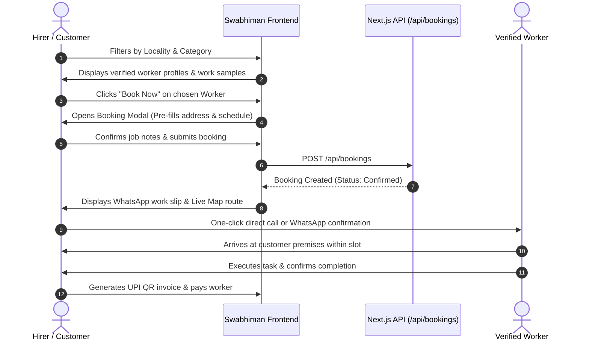
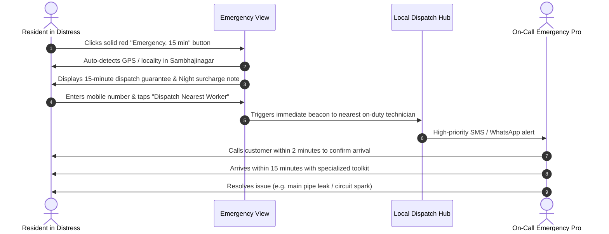
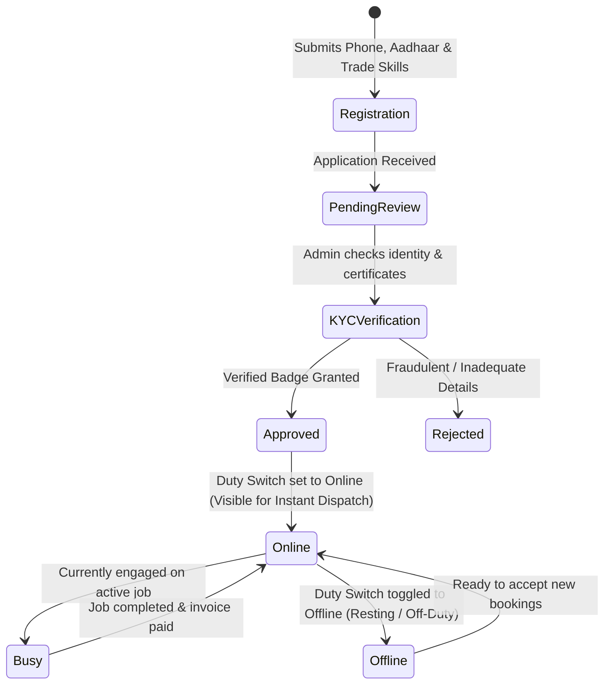
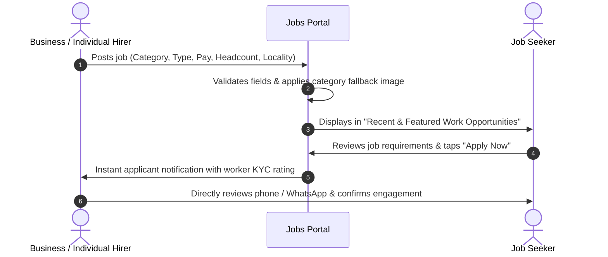
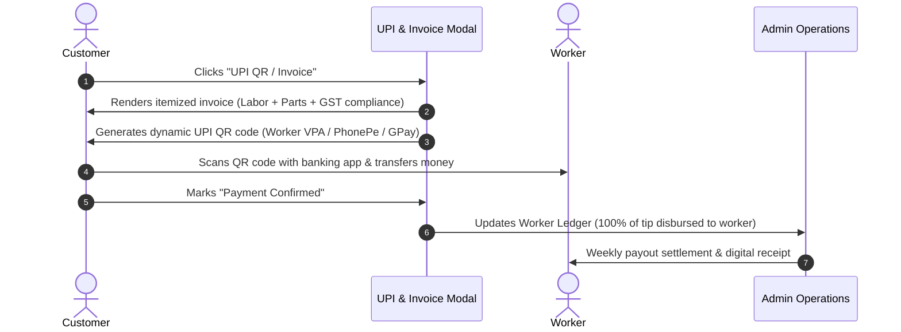
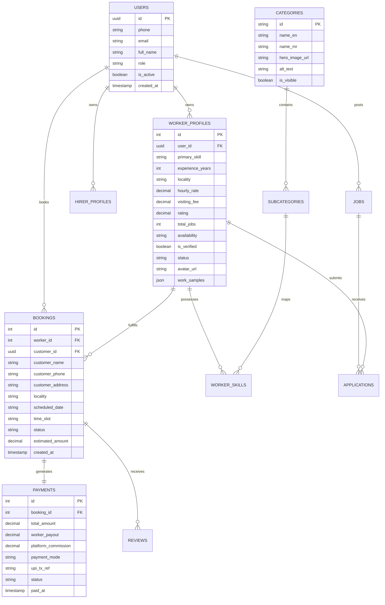

# SWABHIMAN (स्वाभिMAN) / KaamSetu
## Universal Work & Task Marketplace — Complete Architecture, Workflow & User Guide

> **Version:** 2.4.0  
> **Status:** Production-Ready  
> **Region:** Chhatrapati Sambhajinagar (Aurangabad), Maharashtra, India  
> **Core Promise:** *"One platform. Every skill. Every kind of work."*

---

## Table of Contents
1. [Executive Overview & Product Vision](#1-executive-overview--product-vision)
2. [Technical Stack & Architecture](#2-technical-stack--architecture)
3. [Visual Asset & Media Architecture](#3-visual-asset--media-architecture)
4. [Universal Categories & Occupational Taxonomy](#4-universal-categories--occupational-taxonomy)
5. [The 9 Universal Work & Task Models](#5-the-9-universal-work--task-models)
6. [Core System Workflows & Sequence Diagrams](#6-core-system-workflows--sequence-diagrams)
   - [Workflow A: Hirer Instant Booking & Direct Dispatch](#workflow-a-hirer-instant-booking--direct-dispatch)
   - [Workflow B: 24/7 Rapid 15-Minute Emergency Dispatch](#workflow-b-247-rapid-15-minute-emergency-dispatch)
   - [Workflow C: Worker Onboarding, KYC & Duty Switch](#workflow-c-worker-onboarding-kyc--duty-switch)
   - [Workflow D: Job Posting & Worker Application Flow](#workflow-d-job-posting--worker-application-flow)
   - [Workflow E: UPI QR Invoicing & Worker Payout Ledger](#workflow-e-upi-qr-invoicing--worker-payout-ledger)
7. [Comprehensive User Guides](#7-comprehensive-user-guides)
   - [Guide 1: For Hirers & Customers](#guide-1-for-hirers--customers)
   - [Guide 2: For Workers & Skilled Pros](#guide-2-for-workers--skilled-pros)
   - [Guide 3: For Platform Administrators](#guide-3-for-platform-administrators)
8. [Database Schema & Entity Relationship Diagram (ERD)](#8-database-schema--entity-relationship-diagram-erd)
9. [Trust, Safety & Night Charge Compliance](#9-trust-safety--night-charge-compliance)
10. [Local Development, Build & Deployment Guide](#10-local-development-build--deployment-guide)

---

## 1. Executive Overview & Product Vision

**SWABHIMAN (स्वाभिमान)** is a universal, hyper-local work and task marketplace. The platform bridges the gap between individuals, households, and businesses who need work done and verified local workers across **Chhatrapati Sambhajinagar (Aurangabad)**.

### Key Differentiators:
- **Universal Scope:** Not limited to traditional trades. Covers **10 broad sectors** spanning blue-collar, grey-collar, agricultural, creative, digital, and professional services.
- **Zero Middleman Markup:** Customers pay transparent visiting charges and hourly/daily rates directly to workers without exploitative broker deductions.
- **Dignity of Labor (स्वाभिमान):** Workers own their profiles, receive 100% of their customer tips, and build direct client relationships.
- **Dual-Mode System:** A single unified account allows users to toggle between **"Find Work" (Worker Mode)** and **"Hire People" (Hirer Mode)** seamlessly.
- **High-Accessibility Design:** Bilingual in **Marathi (मराठी)** and **English**, vernacular voice synthesis for illiterate or low-vision users, minimum 44px touch targets, and strict dark/light mode tokens adhering to WCAG 2.1 AA standards.

---

## 2. Technical Stack & Architecture



### Component Architecture:
- **Framework:** Next.js 16.4.6 with TypeScript and React 19.
- **Styling & Tokens:** Tailwind CSS with custom CSS variables supporting Light (`#FBF8F2`) and Dark (`#0B1220`) modes, `#F2A900` gold accent, `#C2331F` emergency red, and Plus Jakarta Sans typography.
- **Icons:** Zero emojis in application UI; stroke icons only via `lucide-react`.
- **Localization:** Native i18n dictionary (`I18N.en` and `I18N.mr`) in `lib/swabhiman-data.ts`.
- **State Management:** React hooks with localized storage persistence and custom reactive event listeners (`kaamsetu:catalog-updated`) for instantaneous cross-component updates.

---

## 3. Visual Asset & Media Architecture

The platform features a **Central Image Architecture** ensuring that every category, occupation, task type, and worker profile is represented with realistic, authentic Indian workplace photography.

### Architecture Highlights:
1. **Central Image Catalog (`lib/visual-library.ts`):**
   - Decouples all asset URLs, photographer attribution, alt text, and thumbnail definitions from UI rendering logic.
   - Categorizes imagery into:
     - **Hero Visual Pillars:** Skilled trades, Agriculture & rural, Professional & IT, and Local services.
     - **10 Core Universal Categories:** High-resolution headers and subcategory cards.
     - **9 Universal Task Types:** Visual representations of work engagement formats.
     - **Featured Local Jobs:** Authentic job requirement photos.
2. **SafeImage Resilient Fallback Engine (`components/SafeImage.tsx`):**
   - Prevents broken image icons or page reflows if an external CDN is slow or unreachable.
   - Features animated shimmer skeleton loading states.
   - Automatically falls back to an elegant themed placeholder card with category-specific Lucide stroke icons and initials.
3. **Admin Dynamic Image Customization:**
   - Administrators can review all category images, update image URLs, edit accessibility alt text, and toggle category visibility directly in the Admin Console.
   - Updates persist to `localStorage` and broadcast live across the running application without requiring code changes or rebuilds.

---

## 4. Universal Categories & Occupational Taxonomy

The platform groups all economic activity in the Sambhajinagar region into 10 structured categories:

| # | Sector | Key Occupations | Worker Levels |
|---|---|---|---|
| **1** | **Home & Personal Services** | Electrician, Plumber, Carpenter, Painter, Cleaner, AC Technician, Gardener, Appliance Repair | Level 2 – Level 3 |
| **2** | **Construction & Industrial** | Mason, Welder, Fabricator, Tile & Marble Layer, Machine Operator, Site Supervisor | Level 1 – Level 4 |
| **3** | **Hospitality & Events** | Cook/Maharaj, Banquet Waiter, Kitchen Helper, Event Decorator, Photographer | Level 1 – Level 4 |
| **4** | **Transport & Logistics** | Commercial Driver, Delivery Rider, Warehouse Loader, Packer, Forklift Operator | Level 1 – Level 3 |
| **5** | **Agriculture & Rural Work** | Farm Labourer, Harvester, Tractor Driver, Drip Irrigation Tech, Livestock Caretaker | Level 1 – Level 3 |
| **6** | **Office & Administration** | Data Entry Operator, Receptionist, Tally Accountant, Office Assistant, Telecaller | Level 2 – Level 4 |
| **7** | **Digital & IT Services** | Web Developer, Graphic Designer, Video Editor, SEO Specialist, QA Tester | Level 4 |
| **8** | **Education & Training** | Home Tutor (CBSE/State), Computer Trainer, Music Teacher, Yoga/Fitness Coach | Level 3 – Level 4 |
| **9** | **Care & Personal Assistance** | Elderly Care Companion, Babysitter, Patient Attendant (GDA), Pet Walker | Level 2 – Level 3 |
| **10** | **Retail & Sales** | Counter Sales Assistant, Billing Cashier, Store Merchandiser, Field Sales Rep | Level 2 – Level 3 |

### Worker Skill Classifications:
- **Level 1 (Unskilled):** General helper, loading worker, crop picker, debris cleaner.
- **Level 2 (Semi-skilled):** Painter helper, delivery rider, waiter, data entry assistant.
- **Level 3 (Skilled):** Licensed wireman, certified plumber, custom carpenter, welder, AC technician.
- **Level 4 (Professional):** Software engineer, chartered accountant, commercial photographer, civil supervisor.
- **Level 5 (Regulated/Licensed):** Healthcare providers, structural consultants (requires strict verification).

---

## 5. The 9 Universal Work & Task Models

To avoid forcing every job into a rigid booking pattern, the marketplace provides 9 distinct engagement models:



1. **Quick Task:** Fixed-rate, small repairs (tap leak, fan capacitor, lock fitting) completed under 60 minutes.
2. **Hourly Work:** Clock-based billing with an upfront visiting fee for multi-item tasks, cleaning, or electrical diagnostics.
3. **Daily Wage Work:** Full 8-hour workday engagement for construction helpers, event staff, or farm harvesting.
4. **Shift Work:** Defined shifts (morning, evening, or night) for restaurant waitstaff, banquets, and security attendants.
5. **Project-Based Work:** Staged milestones with formal proposals (e.g., complete home painting, modular kitchen install).
6. **Contract Work:** 1 to 6 month contracts for dedicated office drivers, agricultural harvesters, or data operators.
7. **Permanent Employment:** Full-time recruitment with shortlisting, interviews, and verified background onboarding.
8. **Recurring Work:** Repeat appointments (e.g., weekly garden maintenance, alternate-day cleaning).
9. **Emergency 15-Min Dispatch:** Rapid priority dispatch for bursting pipelines, total power blackout, or broken locks.

---

## 6. Core System Workflows & Sequence Diagrams

### Workflow A: Hirer Instant Booking & Direct Dispatch



---

### Workflow B: 24/7 Rapid 15-Minute Emergency Dispatch



---

### Workflow C: Worker Onboarding, KYC & Duty Switch



---

### Workflow D: Job Posting & Worker Application Flow



---

### Workflow E: UPI QR Invoicing & Worker Payout Ledger



---

## 7. Comprehensive User Guides

### Guide 1: For Hirers & Customers

#### 1. Finding & Filtering Verified Workers
1. Open the homepage at `http://localhost:3000` (or `https://kaamsetu-dun.vercel.app/`).
2. Select your locality from the dropdown (e.g., *Garkheda, CIDCO N-3, Osmanpura, Jalna Road*).
3. Select the work category from the category chips or click **"Browse all categories"** to explore all 10 universal categories.
4. Filter by maximum hourly rate or keyword.
5. Workers appear sorted by rating, showing verified green badges, experience, hourly rate, and visiting charges.

#### 2. Viewing Worker Work Samples & Audio Bios
- Tap any worker's portrait to view their verified photo, tools, past customer reviews, and authentic photo gallery of recent work.
- Tap the **Listen (Speaker)** button to hear their bio read aloud in clear Marathi or English.

#### 3. Booking a Worker
- Tap the gold **"Book now"** button.
- Choose **Immediate (Now)**, **Morning**, **Afternoon**, or **Evening**.
- Enter your street address and a short description of the issue.
- Confirm the booking. You can immediately call or WhatsApp the worker directly.

#### 4. Cost Estimator Wizard
- Click **"Estimate repair cost"** in the results header.
- Select your trade, specify the exact issue (e.g., *Leaking tap, MCB trip, Godrej lock install*), and select urgency.
- The wizard provides an upfront, itemized breakdown of estimated labor and spare parts.

---

### Guide 2: For Workers & Skilled Pros

#### 1. Joining the Platform
1. Click **"More"** in the top navigation and select **"Join as worker"** (or switch to Worker Mode).
2. Enter your full name, mobile number, primary locality in Sambhajinagar, experience (years), and trade.
3. Set your transparent hourly rate and upfront visiting charge.
4. Upload your profile photo and past work photographs.
5. Tap **"Submit Verification Profile"**.

#### 2. Operating the Duty Switch
- Tap **"Duty switch"** in the navigation dropdown.
- Toggle between:
  - **Online (Green):** Visible to customers and available for instant bookings.
  - **Busy (Amber):** Currently at a client site; hides emergency dispatch beacon.
  - **Offline (Gray):** Off-duty; stops incoming notifications.

#### 3. Managing Invoices & Payouts
- Access **"My bookings"** to view confirmed, in-progress, and completed jobs.
- Show the digital UPI QR code to clients upon job completion.
- View your real-time earnings ledger and bank settlement transaction IDs.

---

### Guide 3: For Platform Administrators

#### 1. Accessing the Admin Console
- Click **"More"** in the navigation bar and select **"Admin console"**.

#### 2. Craftsmen Roster & KYC Approval
- View all registered workers, contact numbers, locality, trade, and rating.
- Approve or reject pending worker verification requests with one click.
- Filter by trade or search by worker name.

#### 3. Dispatch Board
- Monitor all live service bookings across Sambhajinagar.
- Filter by status: *All, Confirmed, In-Progress, Completed, Cancelled*.

#### 4. UPI Earnings & Disbursal Ledger
- Review total platform volume (GSV), disbursed wages, tips, and platform commission.
- Execute batch settlements to workers via Instant UPI or IMPS bank transfer.

#### 5. Category & Image Library Management (Sub-Tab 5)
- Open the **"Category & Image Library"** tab.
- Click on any of the 10 Universal Categories to inspect its current imagery, subcategories, and alt text.
- Paste a new high-resolution photo URL and click **"Apply Image to Category"** with live preview.
- Toggle category visibility on or off.
- Click **"Save & Publish"** to persist changes immediately to client sessions.
- Use **"Reset Defaults"** to restore curated catalog photography at any time.

---

## 8. Database Schema & Entity Relationship Diagram (ERD)



---

## 9. Trust, Safety & Night Charge Compliance

### 1. 100% Background Check & Identity Vetting
- Every listed worker must undergo identity document inspection (Aadhaar/Voter ID) and phone number OTP verification.
- Skilled occupations (electricians, wiremen) require formal trade certification or verified trade apprentice references.

### 2. 24x7 Night Surcharge Policy
- Standard operating hours: **6:00 AM to 10:00 PM**.
- **Night Service Window:** **10:00 PM to 6:00 AM**.
- Night emergency bookings automatically add a nominal **+₹150 night surge fee**.
- **100% of the night surge fee goes directly to the technician** for night travel and emergency risk.

### 3. Customer Privacy & Direct Contact
- Customer phone numbers and exact home addresses are shared exclusively with the confirmed worker for that specific appointment.
- Customers can report suspicious behavior or rate quality directly via the post-job review dialog.

---

## 10. Local Development, Build & Deployment Guide

### Prerequisites:
- **Node.js:** v18.x or v20+ (Node v24 supported)
- **Package Manager:** npm v9+ (Use `npm.cmd` on Windows PowerShell)

### 1. Local Setup

```powershell
# Clone the repository
git clone https://github.com/ROHIT5552/kaamsetu.git
cd kaamsetu

# 1. Frontend Setup (Next.js 16)
cd marketplace/frontend
npm.cmd install
npm.cmd run dev
# Running at http://localhost:3000 (or http://127.0.0.1:3002)

# 2. Backend Setup (Node / PostgreSQL)
cd ../backend
npm.cmd install
npm.cmd run db:migrate
npm.cmd run db:seed
npm.cmd run dev
# Listening at http://127.0.0.1:3001
```

### 2. Production Build Verification

```powershell
cd marketplace/frontend
npm.cmd run build
```
> Build output: Static prerendered pages for `/`, `/_not-found`, `/robots.txt`, and `/sitemap.xml`, alongside dynamic API handlers (`/api/workers`, `/api/bookings`, `/api/market`, `/api/stats`).

### 3. Cloud Deployment
- **Frontend (Vercel):** Root directory `marketplace/frontend`.
- **Backend (Render):** Root directory `marketplace/backend`.
- **Database:** Managed Neon Serverless PostgreSQL.
